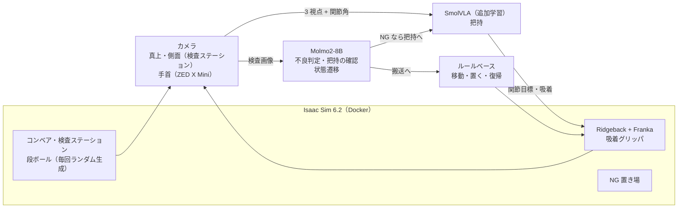

# 段ボールの外観検査と不良品の自動仕分け

Physical AI 応用1 講座の最終課題です。Isaac Sim 上に工場の検査ラインのデジタルツインを作り、

- **Molmo2**（VLM）がコンベアで流れてくる段ボールを外観検査して、上位の判断と状態遷移を受け持ち、
- **SmolVLA**（VLA）が不良品を吸着グリッパでつかみ、
- ルールベースの動作で移動ロボット（Ridgeback + Franka）が不良品置き場へ運んで置く、

という「VLM が上位、VLA が下位」の階層構成で、不良品の仕分けを自動化します。

## システム構成



ライン 1 箱分の流れ:

1. 箱が検査位置に来るとベルトが止まり、腕は検査の邪魔にならない位置へ退避する
2. 斜め照明を当てて真上・側面のカメラで撮影し、Molmo2 が不良（NG / REJECT の表示、破れ、凹み）を判定する
3. 良品ならそのまま流す。不良品なら腕をホーム姿勢に戻し、SmolVLA が吸着して持ち上げる
4. Molmo2 が側面と手首のカメラで把持できたかを確認する。失敗なら箱を離し、SmolVLA を起動し直す（最大 3 回）。吸着を入れたのに何も付いていない状態が 2 秒続いたら、空振りとみなして早めに打ち切る
5. 台車が NG 置き場まで移動して箱を置き、ラインに戻ってベルトを再開する

## リポジトリ構成

```
sim/             シミュレーション環境と動作
  scene.py         ライン・検査ステーション・NG 置き場・ロボット・カメラの構築（USD）
  box_textures.py  段ボールの見た目と不良（NG ラベル・REJECT・破れ・凹み）の生成
  boxes.py         段ボールの 3D 形状（凹み・破れの変形）と物理
  env.py           実行時の制御（コンベア、吸着、カメラ、照明）
  panda_kin.py     Franka の運動学（順運動学・ヤコビアン・IK）
  expert.py        把持デモを作るスクリプトのお手本（軌道の計画）
  skills.py        ルールベースの動作と VLA 把持のスキル
policy/          モデル側（それぞれ別コンテナで動く）
  vlm_inspect.py   Molmo2 による不良判定（チェックリスト方式）
  vlm_server.py    Molmo2 の推論サーバ
  smolvla_server.py SmolVLA の推論サーバ
  to_lerobot.py    収集データを LeRobot v3.0 データセットへ変換
  eval_inspection.py 不良判定の評価
scripts/         収集・評価・実行のスクリプト
  run_cell.py      ライン全体の制御（上記の流れ）
  run_cell.sh      推論サーバ 2 つを立てて run_cell.py を実行し、終わったらサーバを止める
  collect_demos.py 把持デモの収集
  train_smolvla.sh SmolVLA の追加学習
  test_vla_pick.py SmolVLA の把持の評価
  make_video.sh    記録したフレームから動画（MP4）を作る
docker/          各コンテナの起動スクリプト
```

## 動作環境

- Linux、NVIDIA GPU（RTX 系）、Docker と NVIDIA Container Toolkit
- Isaac Sim 6.2 のコンテナイメージ（`nvcr.io/nvidia/isaac-sim:6.2.0.1`、NGC から取得）
- GPU メモリの目安: Isaac Sim 約 6GB、Molmo2-8B（bf16）約 17GB、SmolVLA の推論 約 1〜2GB、SmolVLA の学習（バッチ 64）約 20GB。ライン全体を通しで動かすには、合わせて約 25GB の空きが必要です
- モデルの重みは Hugging Face から自動で取得します（`allenai/Molmo2-8B`、`lerobot/smolvla_base`）

## 使い方

```bash
# 環境の確認（箱が流れて検査位置で止まる）。GUI=1 DISPLAY=:N を付けると画面つき
docker/run.sh sim/run_env.py --seconds 40

# 不良判定の評価: 評価用画像を撮影して Molmo2 で判定
docker/run.sh scripts/make_inspection_set.py --boxes 200 --out data/inspection/eval
docker/vlm.sh policy/eval_inspection.py data/inspection/eval --style checklist

# 把持デモの収集（4 並列）→ LeRobot 形式へ変換 → SmolVLA の追加学習
scripts/run_collection.sh data/raw/run1 4 3 42
docker/convert.sh data/raw/run1 --out data/lerobot/pi_final_suction_pick --workers 6
scripts/train_smolvla.sh

# 学習したチェックポイント（lerobot-train が出力する pretrained_model ディレクトリ）を outputs/models/smolvla_pick に置く

# SmolVLA の把持の評価（推論サーバを立ててから）
docker/policy.sh outputs/models/smolvla_pick &
docker/run.sh scripts/test_vla_pick.py --episodes 20 --out outputs/vla_pick

# ライン全体の実行（推論サーバ 2 つの起動と停止も行う）。録画したフレームから 2 倍速の動画を作る
scripts/run_cell.sh --boxes 12 --record --out outputs/cell
SPEED=2 scripts/make_video.sh outputs/cell/frames outputs/cell/cell_2x.mp4
```

## これまでの結果

**Molmo2-8B の不良判定**（評価用 200 箱、学習なし）

| 方式 | 正解率 | 不良の検出率 | 良品の誤検出 |
|---|---|---|---|
| 判定を一語で答えさせる | 91.0% | 80.9% | 0% |
| チェックリスト（不良の種類ごとに yes/no） | 93.5% | 86.2% | 0% |
| チェックリスト＋腕の退避＋斜め照明＋検査領域の切り出し | 93.5〜95.5% | 87.7〜91.3% | 0% |

不良の種類別の検出率（最終方式、2 セット計 400 箱）は、NG 表示 55/55、REJECT 表示 61/61、破れ 66/68、凹み 46/66 です。残る見逃しは主に浅い凹みです。見本画像を見せる few-shot も試しましたが、検出率が 56.6% に下がったため採用していません。

**把持デモ**: スクリプトのお手本で 503 エピソード（30Hz、107,416 フレーム、真上・側面・手首の 3 視点）を自動収集しました。毎回、箱の大きさ・位置・向き、腕の初期姿勢、台車の位置、照明を変え、軌道にもばらつきとノイズからの復帰を入れています。

**SmolVLA の把持**（`scripts/test_vla_pick.py`、20 回）: 20 回中 19 回成功しました（学習途中のチェックポイント）。成功した回は平均 6.9 秒で、吸着して持ち上げ、ホーム姿勢に戻っています。失敗した 1 回は、箱の上面で吸着を入れたもののくっつかず、そのままやり直さずに止まりました。デモにはやり直しの場面がないため、ライン全体では上位の Molmo2 が失敗を確かめて SmolVLA を起動し直します。

**ルールベースの搬送**: 不良品 3 箱を続けて NG 置き場の別々の場所に置き、ラインへ戻れることを確認しました。

## 現状

- [x] 検査ラインの環境、段ボールと不良の生成
- [x] Molmo2 による不良判定と評価
- [x] 把持デモの収集と LeRobot 形式への変換
- [x] ルールベースの動作（検査中の退避、搬送、置く、復帰）
- [x] SmolVLA の追加学習とシミュレータでの評価
- [x] ライン全体の通し実行と動画

## ライセンスとクレジット

このリポジトリのコードは MIT ライセンスです（`LICENSE`）。

- シミュレータとアセット: NVIDIA Isaac Sim（倉庫・コンベア・ロボット・センサーのモデルは Isaac Sim のアセットを参照しており、このリポジトリには含みません）
- Molmo2: Allen Institute for AI（Apache-2.0）
- SmolVLA と LeRobot: Hugging Face（Apache-2.0）
- フォント: DejaVu（`assets/fonts/LICENSE-DejaVu.txt`）
